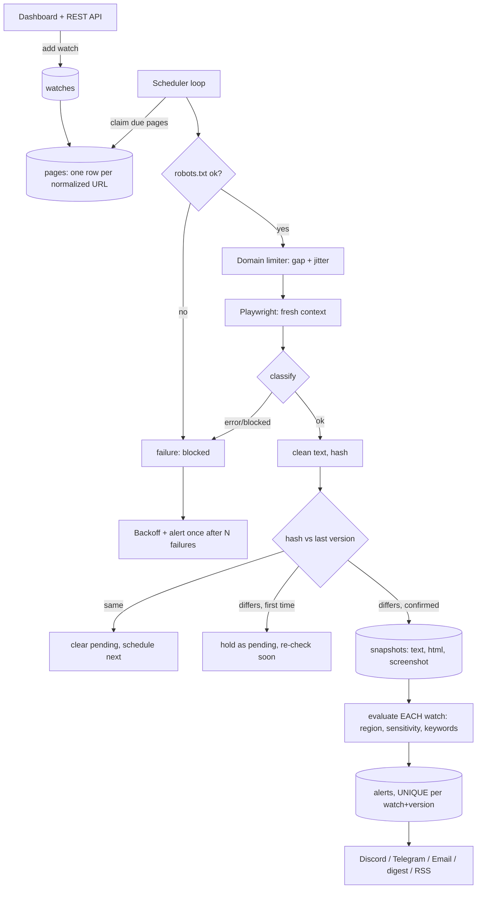

# Architecture

## Data model

- `pages`: one row per normalized URL. Holds status, timings, failure counters and the pending hash. `next_check` is the queue.
- `watches`: one row per subscription. Holds interval, sensitivity, selectors, keywords and notification settings.
- `snapshots`: a new version only when confirmed content changes.
- `alerts`: `UNIQUE(watch_id, snapshot_id, kind)` guarantees one alert per change per watcher.

## Why these choices

- **pages vs watches**: fetch cost scales with distinct URLs, not users.
- **DB-backed queue**: durable, inspectable, and no extra service. Limit: one process.
- **Persistence check over double-fetching**: confirming on the next scheduled check adds no extra load on the target site.
